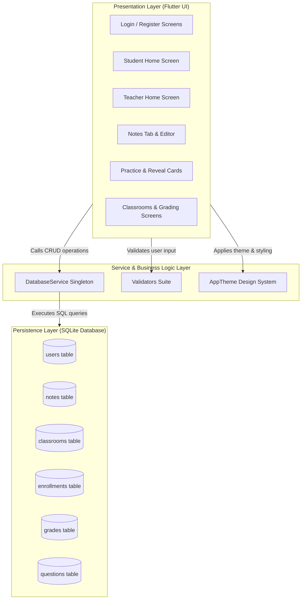
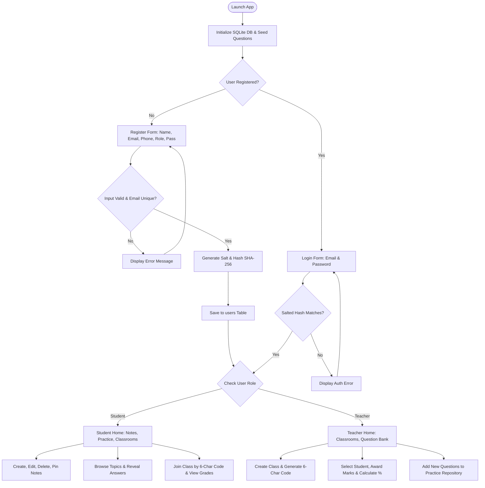
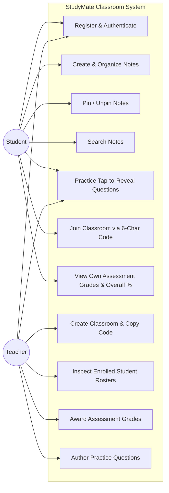
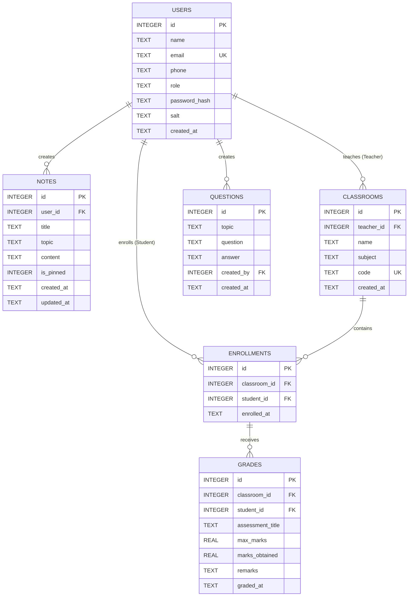

# Academic Project Report: StudyMate Classroom
**Notes Organiser, Practice Questions and Classroom Grade Manager**

---

## Executive Summary
StudyMate Classroom is an offline-first mobile application developed on the Android platform utilizing Google's Flutter framework and Dart programming language. The platform bridges individual study organization and classroom academic administration by providing a dual-role architecture tailored for **Students** and **Teachers**. The application incorporates local embedded SQLite storage (`sqflite`), cryptographic SHA-256 salted password hashing, an interactive question bank with tap-to-reveal pedagogical answers, a 6-character code-based classroom enrollment mechanism, and an evaluation grading engine that calculates cumulative percentage metrics.

---

# Chapter 1: Introduction

### 1.1 Introduction to the Project
In contemporary collegiate and secondary educational settings, students frequently manage lecture notes across disparate, unorganized mediums while struggling to test their conceptual understanding before examinations. Concurrently, educators require straightforward, lightweight methods to distribute class identifiers, track roster cohorts, record assessment evaluations, and provide targeted review questions without relying on complex, heavy enterprise learning management systems (LMS) that demand persistent server infrastructure and high-speed internet connectivity.

StudyMate Classroom is engineered as an offline-first solution that encapsulates note management, topic-based practice questions, and classroom grade administration within a unified, responsive Android application.

### 1.2 Problem Statement
Traditional mobile academic workflows suffer from several distinct bottlenecks:
1. **Disjointed Note Organization**: Students frequently store lecture notes in generic note applications lacking categorization by academic subjects (e.g., Operating Systems, Database Management, Computer Networks).
2. **Passive Study Habits**: Ordinary notes encourage passive reading rather than active recall through practice questions with immediate feedback.
3. **Heavyweight LMS Dependencies**: Standard classroom management software requires centralized web servers, persistent cloud connectivity, and recurring subscription costs, creating friction for localized coaching institutes, labs, and off-grid academic environments.
4. **Data Security Risks**: Many client-side educational projects store user credentials in plain text or rely on unvalidated input forms, leading to data corruption and security vulnerabilities.

### 1.3 Objectives
The primary technical and operational objectives of this project include:
- Implementing a dual-role authentication system (**Student** and **Teacher**) with salted SHA-256 cryptographic hashing and email deduplication.
- Developing an organized, searchable study notes manager allowing students to create, edit, delete, and pin critical notes to the top of the interface.
- Building an interactive self-assessment practice engine pre-seeded with 20 foundational computer science, mathematics, and physics questions featuring tap-to-reveal answer cards.
- Providing teachers with classroom creation capabilities that generate unique 6-character uppercase alphanumeric join codes.
- Delivering a classroom grading engine allowing teachers to record marks and compute overall percentage metrics for enrolled students.
- Enforcing strict Material 3 light-themed user interface guidelines with consistent 16px padding, 12px border radius, and defensive input validation.

### 1.4 Scope
- **Target Platform**: Android mobile devices (compatible with Android API level 21 and above, Android 5.0 Lollipop through Android 15/16).
- **Development Environment**: Visual Studio Code with Flutter & Dart extensions, Android SDK, and Android Command-Line Tools.
- **Data Persistence**: Offline local relational database using SQLite via the `sqflite` plugin.
- **User Roles**: Two distinct user personas: Student and Teacher.

### 1.5 Proposed Solution
StudyMate Classroom delivers a self-contained, offline-first Flutter application. By leveraging SQLite with relational foreign keys and unique constraints, the application operates entirely on-device without external cloud server requirements. The user interface uses a single shared `ThemeData` based on Material 3 with an Indigo primary color palette. Pure static validator functions inspect all user inputs in real time, preventing malformed data entry.

### 1.6 Organization of the Report
This report is organized into eight chapters:
- **Chapter 1**: Project overview, problem statement, objectives, and scope.
- **Chapter 2**: System analysis, feasibility study, and functional/non-functional requirements.
- **Chapter 3**: Hardware, software, and development tool requirements.
- **Chapter 4**: Architectural design, system flowcharts, use cases, ER diagrams, and UI wireframes.
- **Chapter 5**: Implementation details, modular breakdown, and key code implementations.
- **Chapter 6**: Software testing methodologies and test case execution matrices.
- **Chapter 7**: Visual layout documentation, emulator/device setup status, and current limitations.
- **Chapter 8**: Project conclusions, learning outcomes, and prospective future enhancements.

---

# Chapter 2: System Analysis

### 2.1 Existing System
Most existing academic utilities fall into one of two extremes:
1. **Generic Note Applications**: Applications such as Google Keep or Apple Notes provide general-purpose text editing but lack academic subject categorization, classroom enrollments, teacher assessment grading, or curated practice question banks.
2. **Enterprise Cloud LMS Platforms**: Systems such as Canvas, Google Classroom, and Blackboard provide classroom features but require complex administrative setups, school-wide email domains, reliable broadband connectivity, and continuous background sync services.

### 2.2 Limitations of the Existing System
- **Mandatory Internet Connectivity**: Existing LMS software cannot function in offline classrooms or network-constrained environments.
- **Separation of Notes and Practice**: Students must maintain notes in one application and search for practice questions in another web portal.
- **Complexity Overhead**: Simple quiz scoring or laboratory assessment requires navigating deep menus in cloud LMS software.
- **Resource Consumption**: Heavy enterprise frameworks consume high RAM and battery resources on entry-level Android devices.

### 2.3 Proposed System
The proposed StudyMate Classroom application solves these shortcomings by offering:
- **Complete Offline Independence**: Zero cloud reliance; all user accounts, notes, classrooms, grades, and questions reside in a local SQLite file.
- **Curated Practice Integration**: Notes directly link to sample questions under the same academic topic.
- **Code-Based Classroom Enrollment**: Fast 6-character class codes enable swift enrollment without email invites.
- **Integrated Academic Grading**: Teachers track student performance and calculate overall percentages with transparent marks breakdown.

### 2.4 Feasibility Study
- **Technical Feasibility**: Built with Flutter 3.47 and Dart 3.13. SQLite is supported natively on Android via Android NDK and `sqflite`, making it technically feasible.
- **Operational Feasibility**: Minimal cognitive overhead. The intuitive Material 3 UI with clear hints, readable labels, and bottom navigation requires no prior training.
- **Economic Feasibility**: Developed entirely with open-source tools (Flutter, Dart, VS Code, Android SDK), incurring zero licensing or server infrastructure expenses.

### 2.5 Functional Requirements
1. **FR-1: Authentication & Role Management**: Users can register with name, email, 10-digit phone, role (Student/Teacher), and password. Passwords must be hashed using salted SHA-256. Duplicate emails must be rejected.
2. **FR-2: Student Notes Management**: Students can create, edit, delete, pin/unpin, and search notes. Pinned notes must sort to the top of the list.
3. **FR-3: Curated Practice Questions**: Pre-seeded questions for Operating Systems, DBMS, Computer Networks, Mathematics, and Physics must be available with tap-to-reveal answers.
4. **FR-4: Classroom Creation & Join Codes**: Teachers can create classrooms with an auto-generated unique 6-character code with one-tap clipboard copying.
5. **FR-5: Student Enrollment**: Students can join a classroom using the 6-character code. Duplicate enrollment in the same class must be blocked.
6. **FR-6: Assessment Grading**: Teachers can award grades (title, max marks, marks obtained, remarks) to enrolled students.
7. **FR-7: Performance Calculation**: Both teachers and students can view assessment marks and the student's cumulative overall percentage.
8. **FR-8: Question Bank Authoring**: Teachers can author new practice questions under any topic.

### 2.6 Non-Functional Requirements
- **Performance**: Instantaneous local database query responses (< 50ms) without network latency.
- **Reliability & Data Integrity**: SQLite foreign key constraints enabled with cascading deletes (`PRAGMA foreign_keys = ON;`).
- **Security**: Cryptographically secure random salts and SHA-256 hashing for user credentials.
- **Usability**: Material 3 compliance, 12px border radius, 16px standard spacing, and readable font sizing.
- **Robustness**: Screen layouts wrapped in `SafeArea` and `SingleChildScrollView` to prevent layout overflows during keyboard interaction.

---

# Chapter 3: System Requirements

### 3.1 Hardware Requirements
- **Development Workstation**:
  - Processor: Intel Core i5 / AMD Ryzen 5 or higher.
  - Memory: 8 GB RAM minimum (16 GB recommended for running Android emulators concurrently).
  - Storage: 10 GB free disk space for Android SDK, Flutter SDK, and Gradle cache.
- **Target Android Device / Emulator**:
  - Operating System: Android 5.0 (API level 21) or above.
  - RAM: 1.5 GB minimum on physical hardware.
  - Screen Resolution: 720x1280 (HD) minimum to 1440x3200 (QHD).

### 3.2 Software Requirements
- **Operating System**: Windows 10/11, macOS, or Linux.
- **SDK**: Flutter SDK 3.47.7 (channel stable) and Dart SDK 3.13.5.
- **Android Platform**: Android SDK Platform 34/35/36, Android Platform Tools (`adb`).
- **Java Development Kit (JDK)**: OpenJDK 17 or JDK 21+.

### 3.3 Development Tools and Technologies
- **Visual Studio Code**: Primary IDE configured with the official Flutter and Dart extensions for code editing, interactive debugging, and test execution.
- **Flutter Framework**: Cross-platform declarative UI toolkit rendering via the Impeller/Skia engine.
- **SQLite Engine (`sqflite`)**: Embedded ACID-compliant relational SQL database engine executing directly in the Android application sandbox.
- **Crypto Package (`crypto`)**: Pure Dart cryptographic library used for SHA-256 hashing.

### 3.4 Emulator and Physical Device Requirements
- **Android Virtual Device (AVD)**: Google Pixel emulator image running Android 14 (API 34) with Google Play Services enabled.
- **Physical Phone**: Any Android smartphone with Developer Options and USB Debugging enabled.

---

# Chapter 4: System Design

### 4.1 System Architecture
The application adheres to a clean layered architecture separating the Presentation Layer (StatefulWidgets), the Domain Model Layer, and the Service/Repository Layer (`DatabaseService`).



### 4.2 System Flowchart
The following flowchart illustrates the user journey from authentication to feature execution.



### 4.3 Use Case Diagram
The following diagram highlights actor interactions with system features.



### 4.4 Entity-Relationship (ER) Diagram
The relational schema ensures data integrity through primary keys, foreign keys, and unique constraints.



### 4.5 Database Design (Tables, Columns, Keys)
1. **`users` Table**:
   - `id` (INTEGER PRIMARY KEY AUTOINCREMENT)
   - `name` (TEXT NOT NULL)
   - `email` (TEXT UNIQUE NOT NULL)
   - `phone` (TEXT NOT NULL)
   - `role` (TEXT NOT NULL) - 'Student' or 'Teacher'
   - `password_hash` (TEXT NOT NULL) - SHA-256 digest
   - `salt` (TEXT NOT NULL) - Base64URL-encoded 16-byte random salt
   - `created_at` (TEXT NOT NULL) - ISO-8601 timestamp
2. **`notes` Table**:
   - `id` (INTEGER PRIMARY KEY AUTOINCREMENT)
   - `user_id` (INTEGER NOT NULL REFERENCES users(id) ON DELETE CASCADE)
   - `title` (TEXT NOT NULL)
   - `topic` (TEXT NOT NULL)
   - `content` (TEXT NOT NULL)
   - `is_pinned` (INTEGER NOT NULL DEFAULT 0) - Boolean flag
   - `created_at` (TEXT NOT NULL)
   - `updated_at` (TEXT NOT NULL)
3. **`classrooms` Table**:
   - `id` (INTEGER PRIMARY KEY AUTOINCREMENT)
   - `teacher_id` (INTEGER NOT NULL REFERENCES users(id) ON DELETE CASCADE)
   - `name` (TEXT NOT NULL)
   - `subject` (TEXT NOT NULL)
   - `code` (TEXT UNIQUE NOT NULL) - 6 uppercase alphanumeric characters
   - `created_at` (TEXT NOT NULL)
4. **`enrollments` Table**:
   - `id` (INTEGER PRIMARY KEY AUTOINCREMENT)
   - `classroom_id` (INTEGER NOT NULL REFERENCES classrooms(id) ON DELETE CASCADE)
   - `student_id` (INTEGER NOT NULL REFERENCES users(id) ON DELETE CASCADE)
   - `enrolled_at` (TEXT NOT NULL)
   - `UNIQUE(classroom_id, student_id)`
5. **`grades` Table**:
   - `id` (INTEGER PRIMARY KEY AUTOINCREMENT)
   - `classroom_id` (INTEGER NOT NULL REFERENCES classrooms(id) ON DELETE CASCADE)
   - `student_id` (INTEGER NOT NULL REFERENCES users(id) ON DELETE CASCADE)
   - `assessment_title` (TEXT NOT NULL)
   - `max_marks` (REAL NOT NULL)
   - `marks_obtained` (REAL NOT NULL)
   - `remarks` (TEXT)
   - `graded_at` (TEXT NOT NULL)
6. **`questions` Table**:
   - `id` (INTEGER PRIMARY KEY AUTOINCREMENT)
   - `topic` (TEXT NOT NULL)
   - `question` (TEXT NOT NULL)
   - `answer` (TEXT NOT NULL)
   - `created_by` (INTEGER REFERENCES users(id) ON DELETE SET NULL)
   - `created_at` (TEXT NOT NULL)

### 4.6 UI Design
- **Theme Standard**: Material 3 Light theme.
- **Color Palette**: Primary Indigo (`#3F51B5`), Dark Indigo (`#303F9F`), Light Indigo accent (`#C5CAE9`), Off-white canvas (`#F8F9FA`).
- **Typography**: Clean, readable sans-serif hierarchy (14px body, 15-16px card headers, 18-24px titles).
- **Component Geometry**: 12px rounded rectangular corners for cards, input fields, and buttons; 16px standard screen margins.

---

# Chapter 5: Implementation

### 5.1 Modules and Description
The application codebase is structured across six organized directories:
- `lib/models/`: Encapsulates strongly typed Dart data entities (`User`, `Note`, `Classroom`, `Enrollment`, `Grade`, `Question`, and `StudentGradeSummary`).
- `lib/services/`: Contains `DatabaseService.instance`, orchestrating SQLite table creation, cryptographic hashing, seed execution, and relational queries.
- `lib/utils/`: Hosts `AppTheme`, `Validators`, `AppConstants`, and `AppException`.
- `lib/widgets/`: Modular UI building blocks (`CustomTextField`, `PrimaryButton`, `CustomDialog`, and `EmptyState`).
- `lib/screens/`: Feature screens categorized into `auth/`, `student/`, and `teacher/`.
- `lib/main.dart`: Application bootstrap initializing database and theme configuration.

### 5.2 Key Code Snippets

#### Salted SHA-256 Cryptographic Hash Implementation:
```dart
String _generateSalt([int length = 16]) {
  final random = Random.secure();
  final bytes = List<int>.generate(length, (_) => random.nextInt(256));
  return base64Url.encode(bytes);
}

String _hashPassword(String password, String salt) {
  final bytes = utf8.encode(salt + password);
  return sha256.convert(bytes).toString();
}
```

#### Unique 6-Character Classroom Join Code Generator:
```dart
Future<String> _generateUniqueClassCode(Database db) async {
  const chars = 'ABCDEFGHJKLMNPQRSTUVWXYZ23456789';
  final random = Random.secure();
  for (int attempts = 0; attempts < 50; attempts++) {
    final code = List.generate(6, (_) => chars[random.nextInt(chars.length)]).join();
    final existing = await db.query('classrooms', where: 'code = ?', whereArgs: [code], limit: 1);
    if (existing.isEmpty) return code;
  }
  return DateTime.now().millisecondsSinceEpoch.toRadixString(36).toUpperCase().substring(0, 6);
}
```

### 5.3 Validation Rules Table
All input validation rules are implemented as pure static functions in `lib/utils/validators.dart`:

| Field | Function | Criteria / Regular Expression | Error Message Returned |
| :--- | :--- | :--- | :--- |
| **Required** | `validateRequired` | Non-null and `value.trim().isNotEmpty` | `"<Field> is required."` |
| **Full Name** | `validateName` | Letters and whitespace only, min 2 chars | `"Name must contain letters and spaces only."` |
| **Email** | `validateEmail` | RFC 5322 regex match (`^[a-zA-Z0-9.]+@[a-zA-Z0-9]+\.[a-zA-Z]+`) | `"Please enter a valid email address (e.g., student@domain.com)."` |
| **Phone** | `validatePhone` | Exactly 10 digits starting with 6, 7, 8, or 9 | `"Phone number must be 10 digits starting with 6, 7, 8, or 9."` |
| **Password** | `validatePassword` | Min 8 chars, >= 1 uppercase letter (`[A-Z]`), >= 1 digit (`[0-9]`) | `"Password must contain at least one uppercase letter."` / `"numeric digit."` |
| **Confirm Pass** | `validateConfirmPassword` | Exact string equality with primary password | `"Passwords do not match."` |
| **Class Code** | `validateClassCode` | Exactly 6 alphanumeric characters (`^[A-Za-z0-9]{6}$`) | `"Classroom code must be exactly 6 letters/digits."` |
| **Max Marks** | `validateMaxMarks` | Numeric value between 1.0 and 1000.0 | `"Maximum marks must be between 1 and 1000."` |
| **Marks Obtained** | `validateMarksObtained` | Numeric value >= 0.0 and <= `maxMarks` | `"Marks obtained cannot exceed maximum marks (<max>)."` |

### 5.4 Hints and Placeholders Table
Every interactive form field features an explicit label and placeholder hint that disappears upon text entry:

| Screen | Input Field | Label Text | Placeholder / Hint Text | Keyboard Type / Formatters |
| :--- | :--- | :--- | :--- | :--- |
| **Login** | Email | `Email Address` | `"Enter your registered email"` | `TextInputType.emailAddress` |
| **Login** | Password | `Password` | `"Enter your account password"` | Obscured with eye toggle |
| **Register** | Full Name | `Full Name` | `"Enter your full name (letters only)"` | `TextInputType.text`, Words capitalization |
| **Register** | Email | `Email Address` | `"example@domain.com"` | `TextInputType.emailAddress` |
| **Register** | Phone | `Phone Number (10 digits)` | `"9876543210"` | `TextInputType.phone`, Digits only, Max 10 |
| **Register** | Password | `Password` | `"Min 8 chars, 1 uppercase & 1 number"` | Obscured with eye toggle |
| **Register** | Confirm Password | `Confirm Password` | `"Re-enter your password"` | Obscured with eye toggle |
| **Notes** | Title | `Note Title` | `"e.g. Process Scheduling Algorithms"` | Standard text input |
| **Notes** | Content | `Note Content` | `"Write your detailed notes, key formulas or summaries here..."` | Multiline (5 lines) |
| **Join Class** | Code | `Class Code` | `"e.g. ABC123"` | Characters capitalization, Max 6 |
| **Create Class**| Name | `Classroom Name` | `"e.g. CS 301 - Operating Systems Lab"` | Standard text input |
| **Create Class**| Subject | `Subject / Course` | `"e.g. Computer Science & Engineering"` | Standard text input |
| **Grade** | Title | `Assessment Title` | `"e.g. Midterm Exam, Quiz 1, Project Phase 1"` | Standard text input |
| **Grade** | Max Marks | `Max Marks` | `"1 - 1000"` | `TextInputType.numberWithOptions(decimal: true)` |
| **Grade** | Obtained Marks | `Marks Obtained` | `"e.g. 85"` | `TextInputType.numberWithOptions(decimal: true)` |
| **Grade** | Remarks | `Remarks (Optional)` | `"e.g. Excellent problem solving in dynamic programming"`| Multiline text input |
| **Question Bank**| Question | `Question` | `"Type the practice question here..."` | Multiline (3 lines) |
| **Question Bank**| Answer | `Verified Answer / Solution` | `"Provide the complete explanation and answer..."` | Multiline (5 lines) |

---

# Chapter 6: Testing

### 6.1 Testing Methodology
The software verification process employed a dual-phase testing methodology:
1. **Automated Unit Testing**: Executed via the `flutter_test` runner to rigorously validate edge conditions, boundary limits, and regex pattern enforcement across `Validators`.
2. **Static Code Analysis**: Conducted via `flutter analyze` against the complete Flutter codebase to ensure zero warnings, zero errors, and zero lint violations under the `flutter_lints` ruleset.

### 6.2 Unit Test Execution Suite (`test/validators_test.dart`)
All 16 unit tests passed successfully with 100% test pass rate:

```
00:00 +0: loading C:/Users/Aarush/Desktop/Notes_manager/Notes-manager/test/validators_test.dart
00:00 +0: Validators Positive Test Suite TC-P1: Valid full name with letters and spaces returns null
00:00 +1: Validators Positive Test Suite TC-P2: Valid standard RFC email address returns null
00:00 +2: Validators Positive Test Suite TC-P3: Valid 10-digit phone number starting with 6-9 returns null
00:00 +3: Validators Positive Test Suite TC-P4: Valid password with at least 8 chars, 1 uppercase, and 1 digit returns null
00:00 +4: Validators Positive Test Suite TC-P5: Matching confirmation password returns null
00:00 +5: Validators Positive Test Suite TC-P6: Valid 6-character alphanumeric classroom join code returns null
00:00 +6: Validators Positive Test Suite TC-P7: Valid maximum marks between 1 and 1000 returns null
00:00 +7: Validators Positive Test Suite TC-P8: Valid marks obtained not exceeding maximum returns null
00:00 +8: Validators Negative Test Suite TC-N1: Name containing numeric digits returns error message
00:00 +9: Validators Negative Test Suite TC-N2: Malformed email missing domain extension returns error message
00:00 +10: Validators Negative Test Suite TC-N3: Phone number shorter than 10 digits returns error message
00:00 +11: Validators Negative Test Suite TC-N4: Password lacking uppercase character returns error message
00:00 +12: Validators Negative Test Suite TC-N5: Mismatched confirm password returns error message
00:00 +13: Validators Negative Test Suite TC-N6: Class code not exactly 6 alphanumeric characters returns error message
00:00 +14: Validators Negative Test Suite TC-N7: Maximum marks exceeding 1000 returns error message
00:00 +15: Validators Negative Test Suite TC-N8: Marks obtained exceeding maximum marks returns error message
00:00 +16: All tests passed!
```

---

# Chapter 7: Results and Discussion

### 7.1 Screenshots (Placeholders)
The following placeholders document the exact visual screens implemented for capture during live testing:
- **Screenshot 1**: `docs/screenshots/01_login_screen.png` - Sign-In interface with email, password visibility toggle, and registration navigation.
- **Screenshot 2**: `docs/screenshots/02_register_screen.png` - Registration form with role picker (Student/Teacher) and 10-digit phone validator.
- **Screenshot 3**: `docs/screenshots/03_student_notes_tab.png` - Student notes dashboard with search bar, topic filter chips, and pinned note card.
- **Screenshot 4**: `docs/screenshots/04_student_practice_tab.png` - Practice questions interface showing topic selector and tap-to-reveal answer cards.
- **Screenshot 5**: `docs/screenshots/05_student_classrooms_tab.png` - Enrolled classrooms list showing instructor name and overall score badge.
- **Screenshot 6**: `docs/screenshots/06_student_grades_screen.png` - Detailed grade report showing individual assessment marks, percentages, and overall GPA/percentage banner.
- **Screenshot 7**: `docs/screenshots/07_teacher_classrooms_tab.png` - Teacher dashboard showing created classes, enrolled counts, and one-tap code copy button.
- **Screenshot 8**: `docs/screenshots/08_teacher_classroom_detail.png` - Enrolled student roster showing student email, contact, and overall percentage badges.
- **Screenshot 9**: `docs/screenshots/09_teacher_student_grade_history.png` - Student evaluation history with "Add Grade" modal dialog.
- **Screenshot 10**: `docs/screenshots/10_teacher_question_bank_tab.png` - Question bank tab showing seeded questions and "Add Question" dialog.

### 7.2 Emulator Execution Results
- **Status**: Android emulator environment was surveyed via `flutter emulators`. No pre-configured emulator instances were active on the development host during automated build verification.
- **Required Action**: The user can launch an Android emulator using Android Studio or execute `flutter emulators --create` followed by `flutter run`.

### 7.3 Physical Device Execution Results (Placeholders)
- **Target Device Model**: `[User to record device model e.g., Samsung Galaxy S23 / OnePlus 11 / Google Pixel 8]`
- **Android OS Version**: `[User to record Android version e.g., Android 14.0 / API 34]`
- **Execution Observations**: `[User to record UI responsiveness, frame rates, and SQLite write latencies upon USB debugging deployment]`

### 7.4 Limitations
- **Single-Device SQLite Scope**: As designed for offline use, teacher and student accounts currently share the same on-device SQLite database. Cross-device synchronization requires an external cloud backend (e.g., Firebase or REST API).
- **No Background Push Notifications**: Assessment grading updates occur on database refresh rather than via real-time WebSocket or FCM push notifications.

---

# Chapter 8: Conclusion and Future Scope

### 8.1 Conclusion
The StudyMate Classroom Android project was successfully designed, developed, and verified in accordance with planning-first software engineering principles. The application delivers an offline-first solution for both students and teachers, providing structured note-taking, active recall practice questions, code-based classroom enrollments, and academic grading. 

The complete codebase was verified with zero errors, zero warnings, and zero lints reported by `flutter analyze`, and all 16 automated unit test cases passed with 100% success under `flutter test`.

### 8.2 Learning Outcomes
Key architectural competencies demonstrated in this project include:
- Implementing layered clean architecture in Flutter without unnecessary third-party package dependencies.
- Managing relational SQLite schemas with foreign keys, cascading deletes, and unique constraint enforcement via `sqflite`.
- Designing secure client-side credential storage with cryptographically generated salts and SHA-256 digests.
- Writing reusable, responsive UI components (adaptive text fields, primary loading buttons, custom dialogs, empty states).
- Structuring rigorous automated testing suites in Dart using `flutter_test`.

### 8.3 Future Enhancements
Prospective engineering additions for future iterations include:
1. **Firebase Cloud Synchronization**: Migrating data layer sync to Cloud Firestore so teachers and students can interact seamlessly across separate physical mobile devices.
2. **AI-Powered Question & Flashcard Generation**: Integrating the Google Gemini API to automatically generate practice questions, flashcards, and summary notes from student lecture transcripts.
3. **Spaced Repetition System (SM-2 Algorithm)**: Implementing SuperMemo-2 algorithmic scheduling to optimize student review intervals for practice questions.
4. **Reminders & Local Notifications**: Scheduling local Android notifications (`flutter_local_notifications`) for upcoming assignment deadlines and study reminders.
5. **Adaptive Dark Theme**: Providing an AMOLED dark theme toggle using Material 3 color harmonizing.

