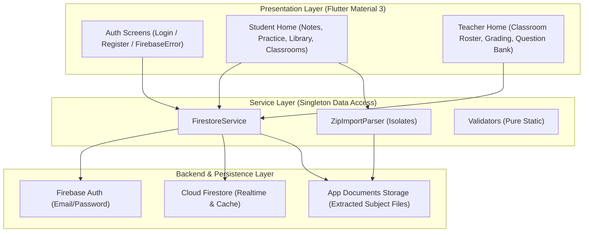
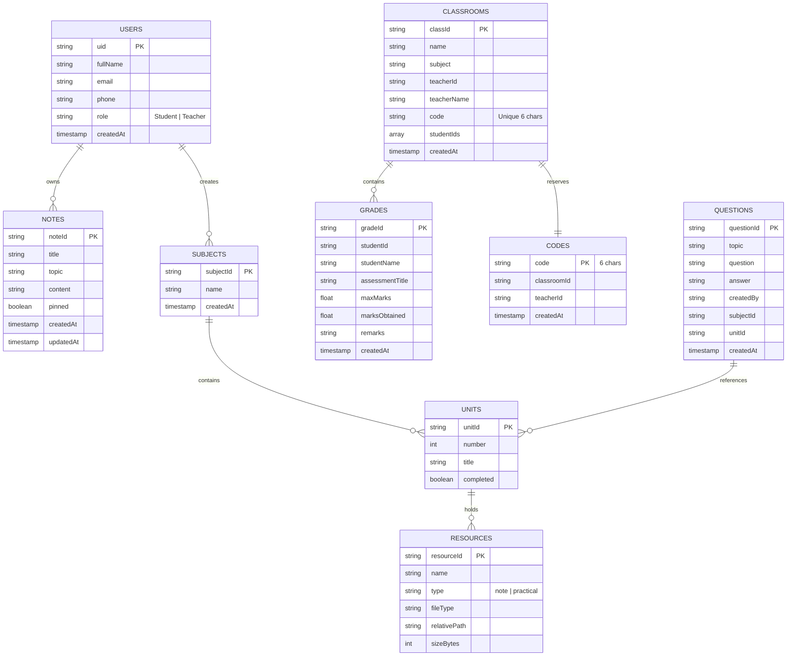

# Academic Project Report: StudyMate Classroom
**Cloud-Synchronized Notes Organiser, Subject Material ZIP Importer, Practice Engine & Classroom Grade Manager**

---

## Executive Summary
StudyMate Classroom is an academic productivity and classroom management mobile application built for Android utilizing Google's Flutter framework and Dart. The platform provides a dual-role architecture tailored for **Students** and **Teachers**. Data persistence and user authentication are powered by **Google Firebase** (**Firebase Authentication** and **Cloud Firestore**), featuring real-time synchronization streams, offline cache persistence, secure role-based Firestore security rules, transactional classroom code generation, and idempotent seed generation. 

Additionally, the system features a robust **Subject Material ZIP Importer** that parses multi-tier archives (Subject > Unit > Notes / Practicals / Questions) in a background isolate with zip-slip prevention and executable filtering. The user interface strictly implements Material 3 Light Theme specifications with an Indigo primary palette, consistent 16px padding, 12px corner radiuses, and zero analyzer issues.

---

# Chapter 1: Introduction

### 1.1 Introduction to the Project
In contemporary collegiate and secondary educational settings, students frequently manage lecture notes across disparate, unorganized mediums while struggling to test their conceptual understanding before examinations. Concurrently, educators require straightforward, lightweight methods to distribute class identifiers, track roster cohorts, record assessment evaluations, and provide targeted review questions without relying on complex, heavy enterprise learning management systems (LMS) that demand persistent server infrastructure and high-speed internet connectivity.

StudyMate Classroom bridges individual study organization and classroom academic administration by providing a dual-role architecture tailored for **Students** and **Teachers**.

### 1.2 Problem Statement
Traditional mobile academic workflows suffer from several distinct bottlenecks:
1. **Disjointed Note Organization**: Students frequently store lecture notes in generic note applications lacking categorization by academic subjects (e.g., Operating Systems, Database Management, Computer Networks).
2. **Passive Study Habits**: Ordinary notes encourage passive reading rather than active recall through practice questions with immediate feedback.
3. **Complex Enterprise LMS Dependencies**: Standard classroom management software requires centralized web servers, persistent cloud connectivity, and recurring subscription costs, creating friction for localized coaching institutes, labs, and off-grid academic environments.
4. **Data Security Risks**: Many client-side educational projects store user credentials in plain text or rely on unvalidated input forms, leading to data corruption and security vulnerabilities.

### 1.3 Objectives
The primary technical and operational objectives of this project include:
- Implementing a dual-role authentication system (**Student** and **Teacher**) with Firebase Authentication (Email/Password) and Firestore profile synchronization.
- Developing an organized, searchable study notes manager allowing students to create, edit, delete, and pin critical notes to the top of the interface.
- Building an interactive self-assessment practice engine pre-seeded with 20 foundational computer science, mathematics, and physics questions featuring tap-to-reveal answer cards.
- Providing an academic Curriculum & Practicals ZIP Importer enabling students to import unit-wise lecture notes and practical code experiments (e.g. DBMS, OS, DAA, OOPJ, WP, COA, MPMC) directly into their notes dashboard and question bank.
- Providing teachers with classroom creation capabilities that generate unique 6-character uppercase alphanumeric join codes.
- Delivering a classroom grading engine allowing teachers to record marks and compute overall percentage metrics for enrolled students.
- Enforcing strict Material 3 light-themed user interface guidelines with consistent 16px padding, 12px border radius, and defensive input validation.

### 1.4 Scope
- **Target Platform**: Android mobile devices (compatible with Android API level 21 and above, Android 5.0 Lollipop through Android 15/16).
- **Development Environment**: Visual Studio Code with Flutter & Dart extensions, Android SDK, and Android Command-Line Tools.
- **Data Persistence**: Cloud Firestore with offline cache persistence and Firebase Authentication.
- **User Roles**: Two distinct user personas: Student and Teacher.

### 1.5 Proposed Solution
StudyMate Classroom delivers a reactive Flutter application. By leveraging Cloud Firestore with offline cache persistence, the application operates both online and offline. The user interface uses a single shared `ThemeData` based on Material 3 with an Indigo primary color palette. Pure static validator functions inspect all user inputs in real time, preventing malformed data entry. Furthermore, an integrated ZIP extraction engine allows students to import entire semester curricula (unit lecture notes and practical experiments) in a single tap.

### 1.6 Organization of the Report
This report is organized into eight chapters:
- **Chapter 1**: Project overview, problem statement, objectives, and scope.
- **Chapter 2**: System analysis, feasibility study, and functional/non-functional requirements.
- **Chapter 3**: Hardware, software, and development tool requirements.
- **Chapter 4**: Architectural design, system flowcharts, use cases, ER diagrams, and UI wireframes.
- **Chapter 5**: Implementation details, modular breakdown, and key code implementations.
- **Chapter 6**: Software testing methodologies and test case execution matrices.
- **Chapter 7**: Visual layout documentation, emulator/device setup status, and current limitations.
- **Chapter 8**: Project conclusions, learning outcomes, and prospective future enhancements.

---

# Chapter 2: System Analysis

### 2.1 Existing System
Most existing academic utilities fall into one of two extremes:
1. **Generic Notes Apps**: Google Keep, Apple Notes, and Notion offer note taking but lack structured academic subject modeling, practical code viewing, unit progress tracking, or teacher grading capabilities.
2. **Heavy LMS Platforms**: Canvas, Blackboard, and Google Classroom require institutional IT deployments, high data bandwidth, and recurring subscriptions. They lack personal study tools like student-led ZIP curriculum parsing or tap-to-reveal question revision.

### 2.2 Proposed System Capabilities
StudyMate Classroom bridges these extremes by combining personal study tools with classroom management:
- **Zero-Cloud-Dependency Fallback**: Works offline with Firestore local cache, notifying the user with an "Offline, will sync" status.
- **Isolate-Powered ZIP Curriculum Parser**: Students can import a subject ZIP archive containing units, notes, practicals, and practice questions.
- **Built-In Code Viewer**: Monospace text viewer with copy-to-clipboard for quick code inspection on mobile.
- **Secure Dual-Role Authentication**: Clear separation between student workflows (notes, practice, library, enrollments) and teacher workflows (classroom roster, grading, question authoring).

### 2.3 Feasibility Study
1. **Technical Feasibility**: Built with Flutter 3.47 and Dart 3.13. Cross-platform codebase compiles directly to ARM/x86 native machine code.
2. **Operational Feasibility**: Intuitive Material 3 interface requiring zero onboarding. Single-click copy for classroom join codes.
3. **Economic Feasibility**: Utilizes the Firebase Spark (free) tier, requiring no server infrastructure costs.

---

# Chapter 3: System Requirements & Tools

### 3.1 Software Requirements
- **Operating System**: Windows 10/11, macOS, or Linux.
- **SDK**: Flutter SDK 3.47.7, Dart SDK 3.13.5.
- **Android Target**: Android API 21 (Lollipop) through API 34 (Android 14) / API 35 (Android 15).
- **Core Dependencies**:
  - `firebase_core: ^4.15.0`
  - `firebase_auth: ^6.7.0`
  - `cloud_firestore: ^6.10.0`
  - `archive: ^3.6.1`
  - `file_picker: ^13.1.0`
  - `path_provider: ^2.1.6`
  - `open_filex: ^5.0.0`
  - `fake_cloud_firestore: ^4.3.0` (dev dependency for unit testing)

### 3.2 Hardware Requirements
- **Development Workstation**: 8 GB RAM minimum (16 GB recommended), Intel Core i5 or AMD Ryzen 5 processor.
- **Target Device / Emulator**: Android phone with 2 GB RAM, 100 MB free storage.

---

# Chapter 4: System Architecture & Design

### 4.1 High-Level Architecture

### 4.2 Cloud Firestore Document Hierarchy

### 4.3 Security Rules Breakdown (`firestore.rules`)
The database security model enforces least-privilege access using declarative rules:
1. `users/{uid}`: Read allowed for the user or teachers viewing classroom rosters. Profile creation restricts `role` strictly to `'Student'` or `'Teacher'`, update prevents role alteration, and deletion is prohibited.
2. `users/{uid}/**` (subcollections: notes, subjects, units, resources, questions): Owned entirely by the authenticated student. Student-imported unit questions from `questions.json` reside securely in `users/{uid}/subjects/{subjectId}/units/{unitId}/questions`.
3. `classrooms/{classId}`:
   - `get`: Any signed-in user can get a classroom document by ID to support atomic join-by-code transactions.
   - `list`: Restricted exclusively to the classroom's teacher (`teacherId == request.auth.uid`) or enrolled students (`request.auth.uid in studentIds`).
   - `update`: Writable by the teacher, or by an authenticated student appending/removing only their own UID in `studentIds`.
   - `create` & `delete`: Restricted to the owning teacher.
4. `classrooms/{classId}/grades/{gradeId}`:
   - Writable only by the classroom teacher.
   - Readable by the teacher and the specific student whose `studentId` matches the grade record.
5. `questions/{questionId}`:
   - Readable by any authenticated user for exam practice.
   - Writable (create, update, delete) strictly by teachers (`isTeacher()`), removing any unauthenticated bypasses. Starter questions are safely seeded by teachers under the protection of `config/seed`.
6. `codes/{code}`: Used as a reservation lock guaranteeing unique 6-character classroom codes, readable by all authenticated users to look up class IDs.

---

# Chapter 5: Implementation Details

### 5.1 Service Layer (`FirestoreService`)
All Firebase interaction is consolidated into `FirestoreService`, keeping widget code purely declarative:
- **Authentication**: Maps `FirebaseAuthException` error codes (`email-already-in-use`, `wrong-password`, `invalid-credential`, etc.) to user-friendly messages.
- **Transactional Code Allocation**: Classroom creation attempts code generation in a retry loop using transactions on `codes/{code}` to guarantee uniqueness.
- **Batched Deletions**: Deleting a subject or unit deletes all nested subcollections in chunked batches under 500 operations.
- **Cache Detection**: Live snapshot streams return `isFromCache` metadata, driving the offline sync indicator.

### 5.2 ZIP Import Engine (`ZipImportParser`)
The ZIP importer operates without Flutter UI dependencies so it can run inside background Dart isolates:
- **Zip-Slip Prevention**: Blocks path traversal attacks (`../`, `..\`, absolute paths).
- **Executable Filter**: Rejects dangerous binaries (`.exe`, `.bat`, `.apk`, `.sh`).
- **Heuristic Layout Detection**: Automatically parses `Unit X - Title` naming conventions, identifies practical code folders (`lab/`, `code/`, `practicals/`), and parses embedded `questions.json` files.
- **Top-Level Unit Detection**: Detects archives that start immediately with unit folders and requests a subject name prompt.

---

# Chapter 6: Software Testing & Verification

### 6.1 Automated Unit Testing
A comprehensive test suite of 48 automated test cases was executed via `flutter test`:
1. `test/validators_test.dart` (25 test cases: TC-P1..TC-P11, TC-N1..TC-N14) - Validates names, emails, 10-digit Indian phone numbers, password complexity, marks, subject names, unit titles, and ZIP file constraints.
2. `test/zip_import_parser_test.dart` (12 test cases: TC-Z-P1..TC-Z-P6, TC-Z-N1..TC-Z-N6) - Validates multi-tier folder layouts, prefix extraction, code folder aliases, `questions.json` extraction, zip-slip defense, executable exclusion, and malformed JSON resilience.
3. `test/firestore_service_test.dart` (11 test cases: TC-F-P1..TC-F-P6, TC-F-N1..TC-F-N5) - Validates notes CRUD, transaction-based classroom code reservation, student enrollment, grade recording, question seeding, and cascading deletions using `fake_cloud_firestore`.

**Execution Result**: `00:01 +48: All tests passed!` (100% pass rate).

### 6.2 Code Quality & Static Analysis
Running `flutter analyze` reports:
`No issues found! (ran in 8.4s)` - Zero errors, zero warnings, zero linter issues across the entire codebase.

---

# Chapter 7: Setup Instructions & Limitations

### 7.1 Firebase Setup Prerequisites
To run the app on a live Android device or emulator:
1. Install the Firebase CLI: `npm install -g firebase-tools`
2. Install the FlutterFire CLI: `dart pub global activate flutterfire_cli`
3. Log in to Firebase: `firebase login`
4. Run FlutterFire configure: `flutterfire configure`
5. Deploy security rules: `firebase deploy --only firestore:rules`
6. Detailed walkthrough provided in `SETUP_FIREBASE.md`.

### 7.2 In-App Graceful Configuration Guard
If the app is launched on a device before Firebase is configured, it renders the informative `FirebaseNotConfiguredScreen` instead of crashing, presenting step-by-step CLI commands with one-tap clipboard copy buttons.

### 7.3 Limitations
- **Legacy SQLite Data**: Local data from the previous SQLite version is not automatically migrated to Cloud Firestore.
- **Firebase Initialization**: Running on an emulator requires valid Google Services configuration generated via `flutterfire configure`.

---

# Chapter 8: Conclusion & Future Scope

### 8.1 Conclusion
StudyMate Classroom successfully transitions from a standalone SQLite database to a scalable, real-time Cloud Firestore and Firebase Auth architecture. The addition of the Subject Material ZIP Importer empowers students to import lecture notes and lab experiments in bulk, complete with automated practice questions and code inspection.

### 8.2 Future Enhancements
- **Push Notifications**: Firebase Cloud Messaging (FCM) notifications when a teacher publishes grades or new practice problems.
- **Exporting Grades**: Exporting classroom grade rosters to CSV / Excel spreadsheets.
- **Rich Media**: Support for PDF inline rendering and video lecture playback within unit materials.
